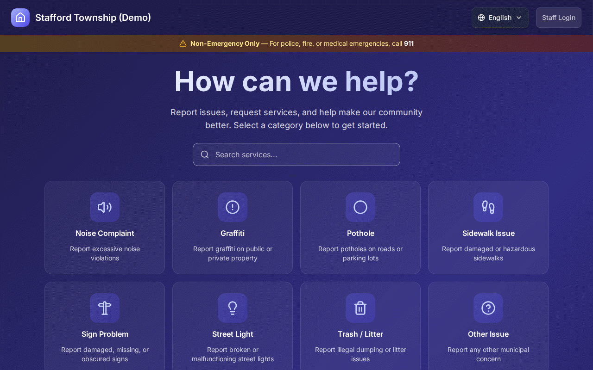
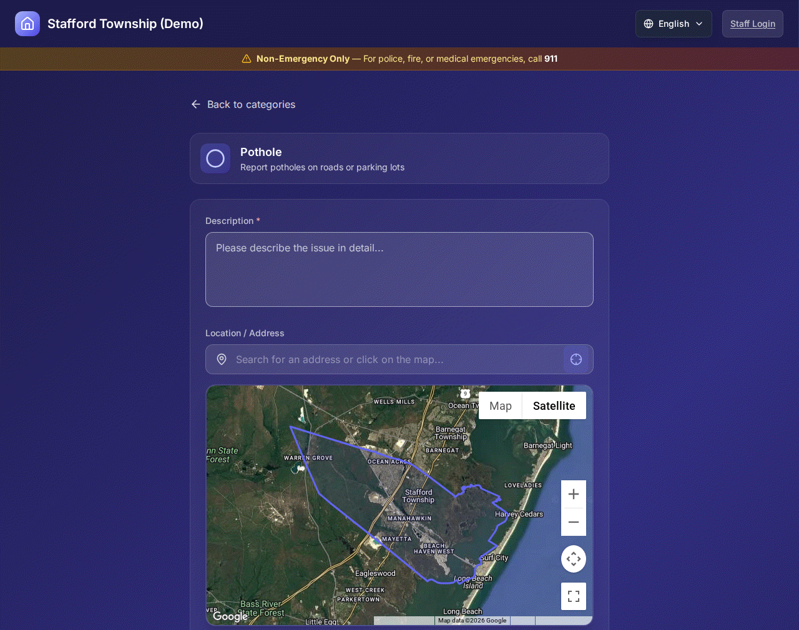
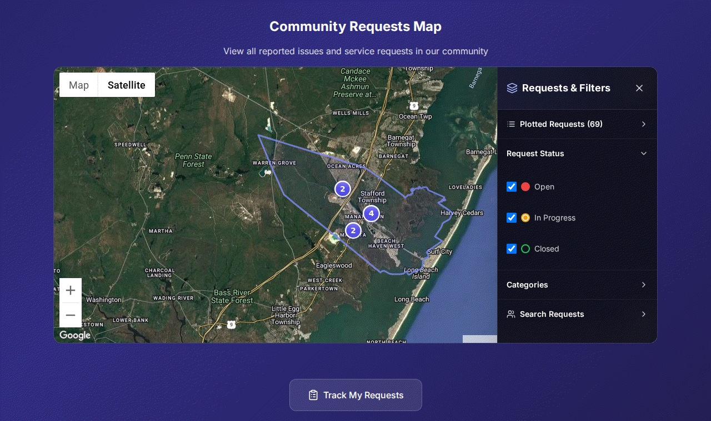
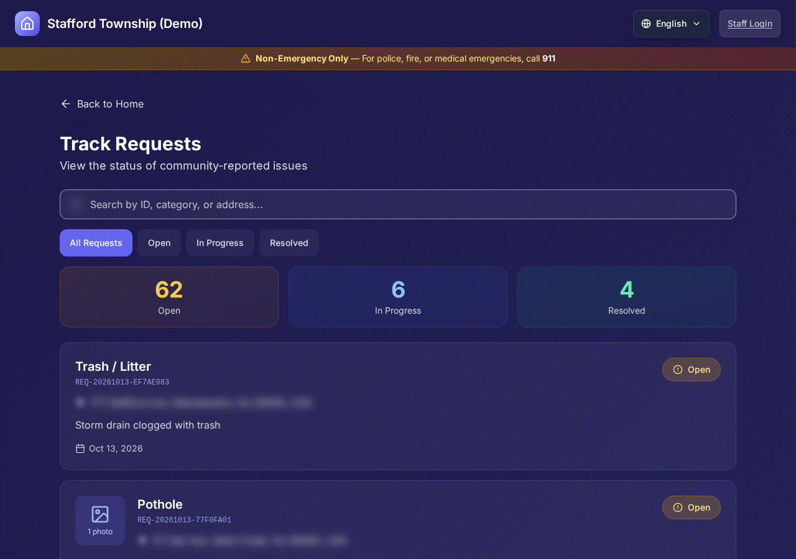
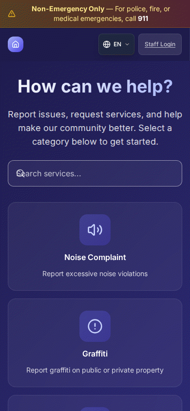
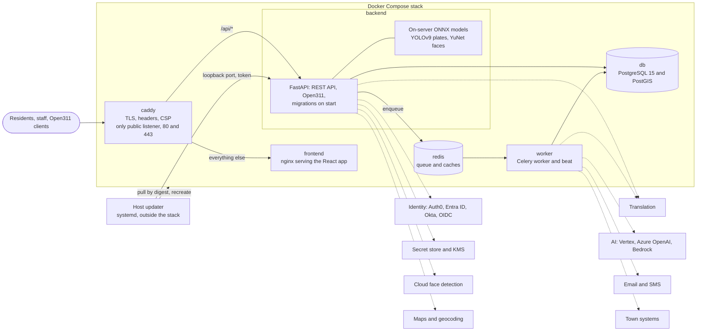
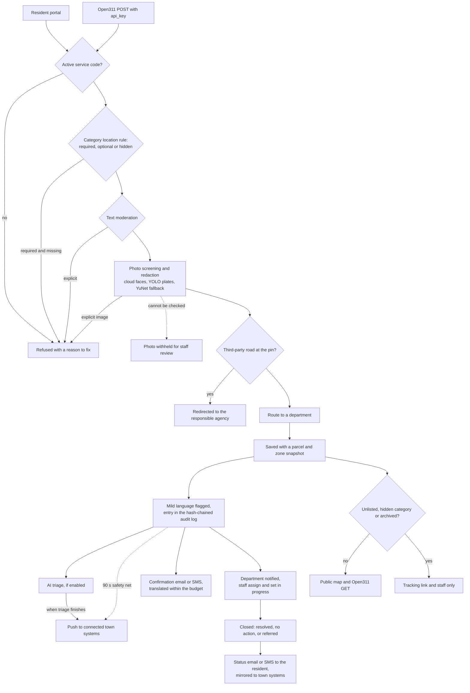
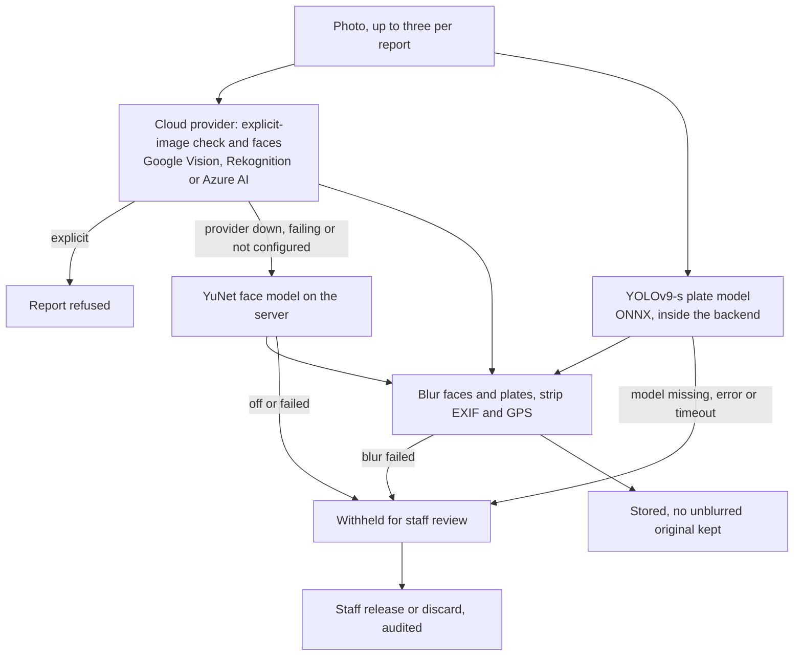
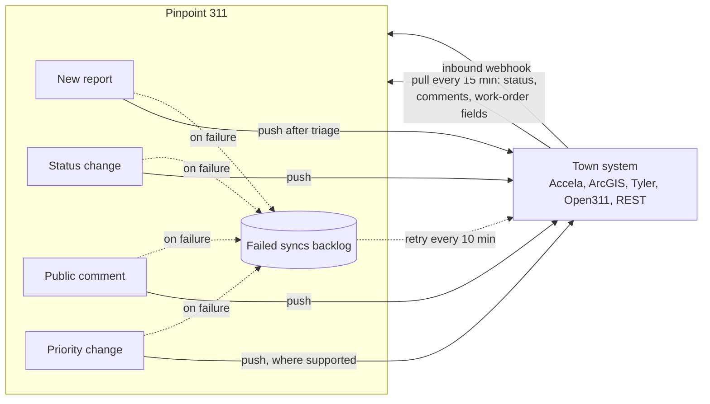
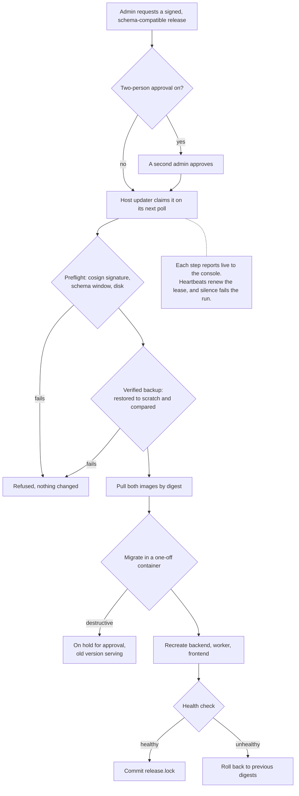

<h1 align="center">
  <picture>
    <source media="(prefers-color-scheme: dark)" srcset="frontend/public/pinpoint311_logo_dark_transparent.png">
    
  </picture>
</h1>

<p align="center"><strong>Open-source, self-hosted 311 for small and mid-size towns.</strong></p>

<p align="center">
  <a href="https://pinpoint311.org"></a>
  <a href="LICENSE"></a>
  <a href="https://hcb.hackclub.com/pinpoint-311"></a>
  <a href="https://github.com/Pinpoint-311/Pinpoint-311/actions/workflows/build-publish.yml"></a>
  <a href="https://github.com/Pinpoint-311/Pinpoint-311/actions/workflows/accessibility.yml"></a>
</p>

<p align="center">
  <a href="https://demo.pinpoint311.org">Live demo</a> &middot;
  <a href="#try-it">Try it</a> &middot;
  <a href="#how-it-works">How it works</a> &middot;
  <a href="docs/API.md">API</a> &middot;
  <a href="#documentation">Docs</a>
</p>

Residents report non-emergency problems (a pothole, a broken streetlight, a
missed pickup) without creating an account. Staff triage, route and close them
from one dashboard, and administrators configure everything in the browser. The
town runs it on its own server and owns the database. MIT-licensed, no per-seat
fees, and it keeps working when any optional cloud service is off.

## At a glance

<table>
  <tr>
    <td width="33%" valign="top"><strong>No-account reporting</strong><br>Pick a category, drop a pin, add up to three photos, and track the report through a private link.</td>
    <td width="33%" valign="top"><strong>One staff queue</strong><br>List, map, and detail views, scoped to each staff member's departments.</td>
    <td width="33%" valign="top"><strong>Configured in the browser</strong><br>Branding, users, departments, categories, routing, and every provider credential.</td>
  </tr>
  <tr>
    <td valign="top"><strong>Privacy by default</strong><br>Resident contact details are encrypted at rest; faces and plates are blurred before a photo is stored.</td>
    <td valign="top"><strong>Optional AI, never in charge</strong><br>Suggests a priority and summary. It never routes, assigns, or closes a report.</td>
    <td valign="top"><strong>More than 100 languages</strong><br>Interface, categories, and resident text, under a daily and monthly translation budget.</td>
  </tr>
  <tr>
    <td valign="top"><strong>Connects to town systems</strong><br>Accela, Esri ArcGIS, Tyler, any Open311 endpoint, or a generic REST API.</td>
    <td valign="top"><strong>Records and audit</strong><br>Retention set by the clerk, legal holds, and hash-chained audit logs with an integrity check.</td>
    <td valign="top"><strong>Signed, approved upgrades</strong><br>Signed images pinned by digest, upgraded from the console with a second admin's approval.</td>
  </tr>
</table>

## Screenshots

From the public pages of the [generic demo](https://demo.pinpoint311.org). Street
addresses in the tracker are blurred.

<table>
  <tr>
    <td width="50%"></td>
    <td width="50%"></td>
  </tr>
  <tr>
    <td align="center"><em>Residents start by choosing a category.</em></td>
    <td align="center"><em>The report form: describe, locate, attach photos.</em></td>
  </tr>
  <tr>
    <td></td>
    <td></td>
  </tr>
  <tr>
    <td align="center"><em>The public map, with personal details removed.</em></td>
    <td align="center"><em>Anyone can follow the status of community reports.</em></td>
  </tr>
</table>

<details>
<summary>Mobile view</summary>

<p align="center"></p>

</details>

## Try it

On a Linux host with Docker Engine and the Compose plugin:

```bash
git clone https://github.com/Pinpoint-311/Pinpoint-311.git
cd Pinpoint-311
cp .env.example .env    # then set DB_PASSWORD, SECRET_KEY, and INITIAL_ADMIN_PASSWORD
scripts/build-release.sh --latest   # or use the published images, see Quick start
docker compose up -d
docker compose logs -f backend
```

Then open `https://<your DOMAIN>` (or `https://localhost`) and choose
**Staff Login > Enter Admin Console**. Read the [Quick start](#quick-start)
before going live.

## Who it's for

| Role | What they get | Where to read |
| --- | --- | --- |
| Resident | Report without an account, follow a private status link, browse the public map | [Features](docs/FEATURES.md#resident-portal) |
| Staff | One queue, triage panel, notes, assignment, printable work orders | [Features](docs/FEATURES.md#staff-dashboard) |
| Administrator | Branding, users, departments, categories, routing, retention, and providers in the browser | [Features](docs/FEATURES.md#admin-console), [Configuration](docs/CONFIGURATION.md) |
| Researcher | An optional Research Suite the town can switch on: request volume, response times and geographic patterns, with CSV and GeoJSON exports that leave out free text and direct identifiers | [Features](docs/FEATURES.md#research-lab) |
| Town IT | A Docker Compose stack, one public listener, encrypted backups, signed upgrades only when you approve them | [Quick start](#quick-start), [Security model](#security-model), [Operations](docs/OPERATIONS.md) |
| Developer | FastAPI and React code, an Open311 API, pytest and Vitest suites | [How it works](#how-it-works), [API](docs/API.md), [Development](docs/DEVELOPMENT.md) |

## How it works

**System architecture.** Caddy is the only public listener; the host updater runs outside the stack and reaches the backend on loopback.

<details>
<summary>System architecture</summary>



</details>

**Request lifecycle.** The resident portal and an Open311 `POST` with an API key share one intake path (`backend/app/api/open311.py`).

<details>
<summary>Request lifecycle</summary>



</details>

**Photo privacy.** Faces and plates are blurred on the full-size photo before it is stored, and the pipeline fails closed ([details](docs/PHOTO_REDACTION_MODELS.md)).

<details>
<summary>Photo privacy pipeline</summary>



</details>

**Town-system sync.** Pushes and pulls run in the worker; a failed sync goes to a backlog and is retried ([details](docs/INTEGRATIONS.md)).

<details>
<summary>Town-system sync</summary>



</details>

**Secure upgrades.** Admins request and approve in the console; only the host updater touches Docker ([details](docs/OPERATIONS.md#upgrades)).

<details>
<summary>Secure upgrades</summary>



</details>

## Features and configuration

The portal, dashboard, console, Open311 API and Research Lab are described in
[docs/FEATURES.md](docs/FEATURES.md). Deployment values live in `.env`; the rest is
set in the Admin Console, and every optional service can stay off
([docs/CONFIGURATION.md](docs/CONFIGURATION.md)).

## Quick start

You need a Linux host with Docker and the Compose plugin (2 vCPUs, 4 GB RAM) and,
for HTTPS, a DNS name pointing at it with ports 80 and 443 open.

1. **Create `.env`** from `.env.example`: set `DB_PASSWORD`, `SECRET_KEY` (`openssl rand -hex 32`), `INITIAL_ADMIN_PASSWORD`, `DOMAIN`, and `TENANT_CADDY_PATH` ([all variables](docs/CONFIGURATION.md)).
2. **Edit the `Caddyfile`**: delete every site block after `{$DOMAIN:localhost}` except the `import /etc/caddy/tenants/*.caddy` line, and remove `import noindex` if the portal should be indexed by search engines.
3. **Start the stack** with `scripts/build-release.sh --latest && docker compose up -d`, or the published images (`-f docker-compose.yml -f docker-compose.prod.yml pull`, then `up -d`). In production, pin a signed release in `release.lock` ([docs/RELEASES.md](docs/RELEASES.md)).
4. **Sign in** with **Enter Admin Console** and `INITIAL_ADMIN_PASSWORD`. This bootstrap login stops working once an identity provider is saved.
5. **Finish setup** under **Admin Console > Setup & Integration**: secret store (encrypted database, Google Secret Manager, AWS Secrets Manager or Azure Key Vault), staff sign-in (Auth0, Microsoft Entra ID, Okta or generic OIDC), map provider and boundary, optional services, then users, departments and categories.

> [!IMPORTANT]
> `SECRET_KEY` signs staff sessions and derives the local encryption key. Keep a
> copy somewhere other than the server, and do not change it after launch.

## Security model

Caddy is the only public listener, and every other port is bound to `127.0.0.1`.
Staff sign in through your identity provider, and signing out revokes every
session the account holds. Resident PII is envelope-encrypted under a cloud KMS
or a local key. Audit logs are hash-chained, anchored nightly and verifiable
from the console. Images are signed in CI and pinned by digest. Details and a
diagram: [docs/SECURITY_MODEL.md](docs/SECURITY_MODEL.md).

> [!WARNING]
> Redis has no password and must stay on loopback. Docker's iptables rules
> bypass host firewalls such as `ufw`, so never publish its port.

> [!WARNING]
> Never mount the Docker socket into the backend. It is equivalent to root on the host.

> [!CAUTION]
> If the cloud KMS key that wraps resident PII is destroyed, that data cannot be
> recovered from any backup. See [docs/DISASTER_RECOVERY.md](docs/DISASTER_RECOVERY.md).

## Operations

**Upgrades.** Nothing updates itself, and the old in-app git-based version
switcher is gone. With the [host updater](updater/README.md) installed, an admin
requests an upgrade in **Version Control** and a second admin approves it. By
hand: Take a backup first, pin the release in `release.lock`, then run
`docker compose --env-file .env --env-file release.lock pull` and `up -d`. To
track the newest images instead, use `docker compose pull` with
`docker-compose.prod.yml`.

**Backups and health.** Daily GPG-encrypted backups go to S3-compatible storage
(keep the passphrase off the server; back up `uploads_data` separately), and a
15-minute health scan emails admins. More: [docs/OPERATIONS.md](docs/OPERATIONS.md).

## Integrations, development and accessibility

- **Town systems**: Accela, Esri ArcGIS, Tyler, generic Open311 and generic REST ([docs/INTEGRATIONS.md](docs/INTEGRATIONS.md)).
- **API**: Open311 GeoReport v2 plus the staff API ([docs/API.md](docs/API.md)).
- **Development**: `docker-compose.dev.yml` runs from source with reload; pytest, Vitest and axe suites ([docs/DEVELOPMENT.md](docs/DEVELOPMENT.md)).
- **Centralized hosting** (optional): a state, county or agency can run one instance per town with [Pinpoint-311/centralizedhosting](https://github.com/Pinpoint-311/centralizedhosting). Each town keeps its own database, key and secrets; this repository only carries the hooks, behind `MANAGED_MODE` (off by default). See [docs/VISION.md](docs/VISION.md).
- **Accessibility**: built toward WCAG 2.1 Level AA, with keyboard and screen-reader tests and an axe-core audit in CI. This is a design target, not an independent audit ([COMPLIANCE.md](COMPLIANCE.md#4-accessibility)).

## Reporting security vulnerabilities

> [!IMPORTANT]
> Do not open a public issue for a security vulnerability.

Use **Report a vulnerability** on the [Security tab](https://github.com/Pinpoint-311/Pinpoint-311/security).
We aim to acknowledge reports within 48 hours.

## Documentation

| Document | Contents |
| --- | --- |
| [FEATURES](docs/FEATURES.md), [CONFIGURATION](docs/CONFIGURATION.md) | What everything does, and how to set it |
| [OPERATIONS](docs/OPERATIONS.md), [RELEASES](docs/RELEASES.md), [updater](updater/README.md) | Upgrades, signed releases, the host updater, backups, health |
| [SECURITY_MODEL](docs/SECURITY_MODEL.md), [SECURITY_PLAN](docs/SECURITY_PLAN.md), [PRIVACY_ASSESSMENT](docs/PRIVACY_ASSESSMENT.md), [COMPLIANCE](COMPLIANCE.md) | Security and privacy |
| [PHOTO_REDACTION_MODELS](docs/PHOTO_REDACTION_MODELS.md) | Plate and face models, install, licenses |
| [API](docs/API.md), [INTEGRATIONS](docs/INTEGRATIONS.md), [DEVELOPMENT](docs/DEVELOPMENT.md) | For integrators and contributors |
| [DISASTER_RECOVERY](docs/DISASTER_RECOVERY.md), [SENTRY_SETUP](docs/SENTRY_SETUP.md) | Restore, key loss, crash reporting |
| [COST](COST.md), [deploy/templates](deploy/templates/README.md), [THIRD-PARTY-NOTICES](THIRD-PARTY-NOTICES.md) | Costs, cloud templates, licenses |

## Sustainability and continuity

A town keeps control of its deployment. The full source is MIT-licensed, so it
can be run, modified or forked independently; the data stays in the town's own
PostgreSQL database; updates are applied only when the operator chooses; and a
standalone instance never needs the centralized-hosting control plane.

## License and fiscal sponsorship

Pinpoint 311 is licensed under the [MIT License](LICENSE).

Pinpoint 311 is fiscally sponsored by
[The Hack Foundation](https://hackclub.com/fiscal-sponsorship/) (d.b.a. Hack
Club), a 501(c)(3) public charity (EIN: 81-2908499). Donations made through
[Hack Club Bank](https://hcb.hackclub.com/pinpoint-311) are tax-deductible to the
extent permitted by law.

Pinpoint 311 is also organized as Pinpoint 311 LLC.
