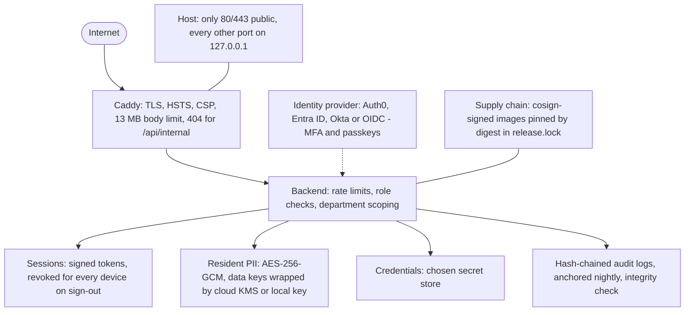

# Security model

How a Pinpoint 311 instance is protected, layer by layer. For the control
mapping and assessments, see [SECURITY_PLAN.md](SECURITY_PLAN.md),
[PRIVACY_ASSESSMENT.md](PRIVACY_ASSESSMENT.md) and
[COMPLIANCE.md](../COMPLIANCE.md).

- [Layers at a glance](#layers-at-a-glance)
- [Network exposure](#network-exposure)
- [Docker socket and supply chain](#docker-socket-and-supply-chain)
- [Headers and CSP](#headers-and-csp)
- [Authentication, roles and sessions](#authentication-roles-and-sessions)
- [Encryption at rest](#encryption-at-rest)
- [Audit logging](#audit-logging)
- [Photo and text privacy](#photo-and-text-privacy)

## Layers at a glance

## Network exposure

- Caddy is the only service published on public interfaces (ports 80 and 443).
- `db`, `redis`, `backend`, and `frontend` publish their ports on `127.0.0.1` only.
- Caddy's admin API listens on port 2019 inside the compose network so the backend can reload it after a domain change. It is not published to the host.
- Caddy rejects request bodies over 13 MB, and the backend enforces a matching limit of its own.
- The host updater's channel (`/api/internal/updater/*`) is answered with 404 by Caddy, refused by the backend when a request carries proxy headers, and requires a hashed, revocable bearer token. The updater reaches it only on the backend's loopback port.

> [!WARNING]
> Redis has no password and must stay on loopback. Docker's own iptables rules
> bypass host firewalls such as `ufw`, which is why the port bindings are
> loopback rather than relying on a firewall.

## Docker socket and supply chain

- No container in `docker-compose.yml` mounts `/var/run/docker.sock`, and the backend image ships without the Docker CLI or git. The in-app, git-based version switcher has been removed.
- Upgrades are done by the host updater, a systemd service outside the stack, which verifies each image's cosign signature against a pinned signer identity, pulls by digest, and records the result in `release.lock`. See [RELEASES.md](RELEASES.md) and [design/secure-upgrades.md](design/secure-upgrades.md#security-analysis).
- Upgrade and rollback requests from the console need a second admin's approval by default, and every request, approval and outcome is audited and emailed to all admins.

> [!WARNING]
> Access to the Docker socket is equivalent to root on the host. Do not add it
> back to the backend in an override file.

## Headers and CSP

- Caddy sets HSTS, `X-Content-Type-Options`, `X-Frame-Options: DENY`, `Referrer-Policy`, and a Content-Security-Policy that allows only the map, font, and identity hosts the app uses.
- The backend sets its own headers on API responses. JSON responses get `default-src 'none'`, API responses are `Cache-Control: no-store`, and `Permissions-Policy` allows only geolocation.
- Caddy writes a JSON access log to the `caddy_data` volume and keeps it for 30 days.
- Interactive API docs are served only when `DEBUG=true`.

## Authentication, roles and sessions

- Staff sign in through the configured identity provider (Auth0, Microsoft Entra ID, Okta, or generic OIDC), which handles MFA and passkeys. Pinpoint stores no staff passwords.
- Until a provider is configured, a one-time bootstrap login uses `INITIAL_ADMIN_PASSWORD`. It stops working as soon as any provider is configured, and repeated wrong passwords are locked out.
- Three roles: `staff` (works reports, scoped by department), `admin` (full access, including the Admin Console), and `researcher` (read-only access to anonymized research data).
- **Signing out ends every session the account holds**, on every device: each token carries the account's session generation, and sign-out increments it.
- Rate limiting is per client address, using a forwarded address that only the trusted proxy can set. Report submission, comments, Open311 keys and bootstrap attempts have their own limits.

## Encryption at rest

- **Resident PII** (name, email, phone) uses envelope encryption. Each value is encrypted with AES-256-GCM under a data key. The data key is wrapped by Google Cloud KMS, Azure Key Vault, AWS KMS, or, when no cloud KMS is configured, a key derived from `SECRET_KEY`. A scheduled task re-wraps data keys when the key manager changes. `REQUIRE_KMS=true` refuses to fall back to the local key.
- **Credentials** are stored in the chosen secret store. In the database store, they are encrypted with a key derived from `SECRET_KEY`.
- **Backups** are encrypted with GPG (AES-256), using a passphrase you set, before they leave the server.
- **Resident IP addresses** recorded for abuse handling are purged on a schedule.

> [!WARNING]
> If the cloud KMS key is destroyed, encrypted PII cannot be recovered from any
> backup. See "Losing the encryption key" in
> [DISASTER_RECOVERY.md](DISASTER_RECOVERY.md).

## Audit logging

- Every change to a service request is written to a hash-chained per-report log (`request_audit_logs`). Sign-ins, admin actions and every authenticated request that changes something go to a second chained log (`audit_logs`).
- The admin log uses **chain version 2**: every hashed value is stored exactly as it is hashed, so any entry can be recomputed from the database alone. IP address and user agent are committed to with a salted digest, so the 90-day IP purge does not look like tampering.
- A nightly task records both chain heads in a separate append-only table and in the application log, so a rewritten history does not pass silently.
- **Verify integrity** in the audit log viewer (`GET /api/audit/verify-integrity`) recomputes the chain and reports breaks and truncation; each report's timeline has its own check.
- Resident-history lookups, research data access, legal-hold changes, Open311 key changes, and upgrade requests and approvals are audited.

## Photo and text privacy

Photos are screened and blurred before they are stored, with no unblurred
original kept, and a photo that cannot be checked is withheld for staff review.
Explicit text is refused and milder language is flagged. See
[FEATURES.md](FEATURES.md#photo-and-content-safety) and
[PHOTO_REDACTION_MODELS.md](PHOTO_REDACTION_MODELS.md).

> [!NOTE]
> Face and plate detection is a mitigation, not a guarantee.
