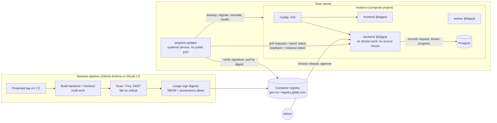

# Secure upgrades: replacing the in-app version switcher

Status: **approved 2026-10-18** (decisions below); Phases 0–3 implemented (Phase 3 not yet run against a live town) · 2026-10-18 · Owner: platform

## Summary

The Admin Console's version switcher runs `git checkout` and `docker compose`
from inside the internet-facing backend container, using the host's Docker
socket. On a server that runs several Pinpoint stacks from one checkout it would
change and restart every stack, and the socket gives the web app
root-equivalent control of the host.

This proposal replaces it with three pieces:

1. **Immutable, signed releases.** CI builds each release once, signs the image
   digests, and stamps them with the schema range they support. Production
   containers run those images by digest and never mount source code.
2. **A host-side updater.** A small service on the host, unreachable from the
   internet, is the only component that can pull images and restart containers.
   It verifies signatures, backs up, migrates, health-checks and rolls back, one
   instance at a time.
3. **Request, approve, observe in the app.** Admins choose a release in the
   console; the app records an audited request; the updater executes it and
   reports progress. The backend loses its Docker socket and its source mount.

Most of the hard logic already exists in the orchestrator that runs
panel-provisioned towns (`centralizedhosting/orchestrator`: cosign verification,
digest pinning, the compatibility window, backup → pull → migrate → recreate,
the destructive-migration approval gate, health probes, rollback). The updater
reuses it rather than writing a second implementation.

## What is wrong today

| # | Problem | Where | Effect |
|---|---|---|---|
| 1 | Shared checkout | Every stack's backend and worker mount the shared checkout's `./backend` | Switching versions from one town changes the code under every stack on the host; their migrations do not run |
| 2 | Wrong compose project | `system.py` `switch_version` guesses the project from a legacy repo name | Falls back to a nonexistent project; `up` with container paths would start a broken duplicate stack; rollback aims at the same wrong project |
| 3 | Docker socket in the backend | `docker-compose.yml` mounts `/var/run/docker.sock` read-write into `backend` | A compromise of the public web app is a compromise of the host |
| 4 | Restart buttons hit the wrong stack | `system.py` maintenance actions run `docker compose` in `/project` with no `-p` | One town's "restart" buttons restart another stack's containers |
| 5 | No release identity | Images built on the server carry no version stamp | `/api/health/quick` reports `version: null`, `git_sha: null`; nothing can say what is running |
| 6 | GitHub only | `GITHUB_REPO` and `api.github.com` are hard-coded for releases, commits, tags and CI status | Hosting on GitLab breaks the release list and security badges |
| 7 | Rebuilds are no-ops | Backends run mounted source, not the image | "Rebuild the backend image" has had no effect on running code |
| 8 | Unpinned CI action | `aquasecurity/trivy-action@master` | The scanner itself is a supply-chain risk |

## Goals and non-goals

Goals:

- An admin can move **one** instance to a **signed** release, with a verified
  backup first and automatic rollback on failure, without shell access.
- The internet-facing containers hold no host privileges.
- Every upgrade is requested, optionally approved by a second admin, executed and
  recorded in the audit log.
- Works with releases hosted on GitHub or GitLab (cloud or self-managed).
- Panel-provisioned towns keep using the orchestrator; self-hosted stacks get the
  same guarantees from the updater.

Non-goals: automatic unattended upgrades (a town opts in to a schedule, never to
silent updates); building images on production servers; multi-host clusters.

## Architecture



### 1. Release pipeline

Already in place (`.github/workflows/build-publish.yml`): builds on `v*` tags,
multi-arch, OCI labels for `version`, `git_sha`, `db_revision` and
`min_db_revision`, keyless cosign signing of the **digest**.

To add:

- **Provenance and SBOM.** `docker buildx --provenance=mode=max --sbom=true`,
  plus `cosign attest` of the SBOM. The updater can then require them.
- **Release gate.** The tag's pipeline must pass (tests, SAST, Trivy with no
  critical findings) before images are signed. An unsigned image cannot be
  deployed, so a failed gate means no release.
- **Pin every action by commit SHA** (fixes problem 8).
- **GitLab parity.** A `.gitlab-ci.yml` release job that does the same, signing
  keylessly through GitLab's OIDC `id_tokens` (issuer `https://gitlab.com` or the
  self-managed URL), and pushing to the GitLab registry.
- **Release notes** from the tag's changelog section, attached to the release.

### 2. Instance layout: immutable images

Each instance pins its images in its own lock file next to its compose override,
written only by the updater:

```dotenv
# /srv/pinpoint/<instance>/release.lock
PINPOINT_VERSION=v1.8.0
BACKEND_IMAGE=ghcr.io/pinpoint-311/pinpoint-311-backend@sha256:…
FRONTEND_IMAGE=ghcr.io/pinpoint-311/pinpoint-311-frontend@sha256:…
```

Compose changes:

- `backend` and `worker` use `image: ${BACKEND_IMAGE}`, `frontend` uses
  `${FRONTEND_IMAGE}`. No `build:` in production.
- Remove the `./backend:/app` mount from `backend` and `worker`, the `.:/project`
  mount and the `/var/run/docker.sock` mount from `backend`. The uploads volume,
  the migration-backups volume and the Caddy tenant directory stay.
- Development keeps a `docker-compose.dev.yml` with build contexts and source
  mounts, so contributors lose nothing.

This also fixes problems 5 and 7: running images carry their release labels, and
`/api/health/quick` reports the real version.

### 3. The host updater

A small Python service, packaged as a systemd unit (recommended) or a container
on an internal network with no published ports. It is the only component with
Docker access. Configuration lists the instances it manages:

```yaml
# /etc/pinpoint-updater/instances.yml
release_source:
  provider: github            # or gitlab
  registry: ghcr.io/pinpoint-311
  api: https://api.github.com # or https://gitlab.example.gov/api/v4
  project: Pinpoint-311/Pinpoint-311
trust:
  issuer: https://token.actions.githubusercontent.com
  identity: '^https://github.com/Pinpoint-311/Pinpoint-311/\.github/workflows/build-publish\.yml@refs/tags/v'
  # or: key: /etc/pinpoint-updater/cosign.pub   (KMS-backed key, see decisions)
instances:
  springfield:
    project: pinpoint-springfield
    dir: /srv/pinpoint/springfield
    compose: [/opt/pinpoint/docker-compose.yml, docker-compose.springfield.yml]
    env_file: .env.springfield
    app_url: http://127.0.0.1:58003
    token_file: updater.token
```

**Talking to the app.** The updater polls each instance's backend over its
loopback port for pending requests and posts progress back. It authenticates
with a per-instance token: random, stored hashed in the instance, shown once at
install. The routes live under `/api/internal/updater/*`; Caddy refuses that
prefix from the internet, and the backend accepts it only with the token. The
app never calls the updater and the updater exposes no port, so there is
nothing new for an attacker to reach.

**One upgrade, step by step** (per instance, under a lock so two never overlap):

1. **Preflight.**
   - Resolve the release to digests.
   - `cosign verify` both against the trust policy; with SBOM/provenance
     required, `cosign verify-attestation` too.
   - Check the instance's observed `db_revision` (from `/api/health/quick`) is
     inside the release's `[min_db_revision, db_revision]` window.
   - Check there is enough disk space and that backups are configured.
   - Any failure stops here with nothing changed.
2. **Backup.**
   - Trigger the instance's encrypted off-site backup (the existing backup
     service) and wait for it to land.
   - Restore it into a scratch database and compare table counts, as in the
     2026-10-18 restore drill. An unverified backup stops the upgrade.
3. **Pull** both images by digest.
4. **Migrate** in a one-off container from the new image
   (`docker compose run --rm backend` running the migration entrypoint).
   - The existing migration gate applies: additive migrations run.
   - A destructive one stops with `needs_approval` and leaves the old version
     serving, exactly as the orchestrator does today.
5. **Recreate** `backend`, `worker`, `frontend` from the new digests (only this
   instance's compose project).
6. **Health.**
   - `/api/health/quick` reports the new version and `db_revision`.
   - The worker heartbeat is fresh.
   - The home page and `/api/services/` return 200.
   - Retried for up to two minutes.
7. **Commit or roll back.**
   - On success, rewrite `release.lock` and report.
   - On failure, recreate from the previous digests. If an additive migration
     ran, the old version still runs on the new schema (that is what
     `MIN_DB_REVISION` guarantees), so no restore is needed.
   - A restore from the step 2 backup is offered to the admin, never automatic.
8. **Report** each step's outcome to the instance, which writes audit entries
   and emails admins.

**Reuse.** `supply_chain.py`, `migrator.py` and the step logic in `rollout.py`
move into a small shared package used by both the orchestrator and the
updater, so the two cannot drift.

**Maintenance actions** (restart a service, clear a cache) move to the same
request channel and run only against the requesting instance's project. This
fixes problem 4.

### 4. In the app

Replaces `/system/update`, `/system/switch-version`, `/system/current-version`,
`/system/releases` and the compose-driven maintenance actions:

| Route | Who | Purpose |
|---|---|---|
| `GET /api/system/releases` | admin | Releases the updater last reported: version, date, notes, signature and gate status, schema compatibility with this instance |
| `POST /api/system/upgrade-requests` | admin | Request an upgrade to a release, with a reason and optional maintenance window |
| `POST /api/system/upgrade-requests/{id}/approve` | admin, not the requester | Second-admin approval when required |
| `POST /api/system/upgrade-requests/{id}/cancel` | admin | Cancel before it starts |
| `GET /api/system/upgrade-requests` | admin | History and live progress |
| `/api/internal/updater/*` | updater token only | Claim requests, report steps, report releases |

The app no longer calls GitHub or GitLab directly. The updater reports the
release list, so the internet-facing app needs no code-host credentials and no
outbound access to them.

Console behaviour:

- **Version Control panel:** current version and digest; available signed
  releases with notes and badges (signature verified, gate passed, schema
  compatible); request with reason and schedule; pending approvals; a live step
  list with outcomes.
- **No updater:** when no updater has ever checked in, the panel says so and
  shows the command-line upgrade steps instead of a button that cannot work.
- **Managed mode:** the panel stays read-only, as now, because upgrades come
  from the orchestrator.

**As built (Phase 3).**

- Routes: `app/api/upgrades.py` (admin, under `/api/system`) and
  `app/api/updater_internal.py` (`/api/internal/updater/*`, access class
  `updater-token`). Rules shared by both live in `app/services/upgrades.py`.
- Tables (in revision `e3a5c7d9f1b2`, additive): `upgrade_requests`,
  `upgrade_request_steps`, `updater_tokens` (hash and prefix only),
  `updater_releases`, and the `updater_settings` singleton.
- Actions: `upgrade`, `rollback`, and `restart`. A restart is
  `docker compose -p <project> restart backend worker frontend` plus the
  health check, run by the updater against this instance's project only. The
  runbook's `restart-*` actions answer `410`. `clear-cache`, `vacuum` and
  `restore` stay in the runbook, since they need no host access.
- Approval: `require_two_person_approval` is on by default. Upgrades and
  rollbacks need an admin other than the requester. **Restarts need one
  admin**: they change no code or schema, they are the incident lever, and they
  were single-admin before. Any admin may cancel a request the updater has not
  claimed. The updater re-checks approvals, and an instance can pin two-person
  approval host-side (`require_two_person_approval: true` in `instances.yml`),
  so turning the setting off in the console cannot remove it there.
- Requests: an upgrade must name a release the updater reported as
  signature-verified and compatible, and the backend re-checks its live
  `alembic_version` against the window. Only one upgrade or rollback can be
  active at a time, and a restart never runs beside a claimed job.
  `allow_destructive` is an explicit, audited opt-in, valid only on upgrades.
  A run held as `needs_approval` is terminal: file a new request with the
  opt-in.
- Fences on the internal prefix: the bearer token (hashed, constant-time,
  revocable, `last_used_at` recorded); a Caddy `handle /api/internal/* {
  respond 404 }` in `pinpoint_site`; the backend answering `404` to anything
  carrying proxy headers; and `404` in managed mode.
- Audit events: `upgrade_request_created`, `_refused`, `_approved`,
  `_approval_refused`, `_cancelled`, `_claimed`, `_finished`, `_marked_failed`,
  `_late_report`,
  `upgrade_settings_changed`, `updater_token_created`, `_revoked`. Every admin
  is emailed when a request is filed, when a run is held for a destructive
  migration, and when a run finishes.
- Removed: `/system/update`, `/system/switch-version`,
  `/system/releases/{ref}/security`, `/system/self-management`, the GitHub
  calls, every `subprocess` call in `system.py`, and
  `app/services/self_management.py`. `/system/current-version` returns the
  image stamp and the digests the updater reported.
- Lease: a claimed or running request with no claim, step or outcome report
  for `UPGRADE_LEASE_MINUTES` (default 45; restarts
  `UPGRADE_RESTART_LEASE_MINUTES`, default 10) becomes `failed` with "The
  updater stopped reporting; check the server". It is audited and every admin
  is emailed. The lease is applied lazily on every read (admin list and
  detail, the updater's pending call, before any report) and by a Celery beat
  sweep every five minutes. A late report from a revived updater gets `409`,
  is logged and audited (`upgrade_request_late_report`), and is never
  applied. An admin can also mark an in-flight request failed
  (`POST /upgrade-requests/{id}/fail`, audited). Heartbeats keep long steps
  alive: while a run is in progress the updater calls
  `POST /api/internal/updater/requests/{id}/heartbeat` every 60 s from a
  daemon thread, which stops when the run ends or raises. A heartbeat renews
  `last_report_at` only, with no step row and no audit entry. If one is
  refused with `409` (the lease ran out anyway, or an admin marked the request
  failed), the updater logs it loudly, finishes the run (stopping halfway is
  worse), posts nothing more, and records "console lost track" in its local
  outcome.
- Turning two-person approval off emails every admin and names the host-side
  floor. Turning it on is audited only.
- Timer: `poll` runs every minute. An idle pass costs two loopback calls per
  connected instance and one health read. The release list (release API,
  registry, cosign) is rebuilt at most hourly (`release_refresh_seconds`) or
  right after a run; in between, the cached list is republished with only the
  schema check redone.

### 5. Release source: GitHub or GitLab

| | GitHub | GitLab (cloud or self-managed) |
|---|---|---|
| Registry | `ghcr.io` | `registry.gitlab.com` or the instance registry |
| Releases and notes | Releases API | Releases API |
| Gate status | Actions run for the tag's commit | Pipeline status for the tag |
| Keyless signing issuer | `token.actions.githubusercontent.com` | `gitlab.com`. Self-managed GitLab: public Sigstore (Fulcio) does not trust arbitrary self-managed issuers, so sign with a key (ideally KMS-held) or run a private Sigstore |
| Updater credential | Read-only package token, only if the registry is private | Deploy token with `read_registry` |

The provider is configuration in the updater, never code. The app only sees the
normalized release list.

## Security analysis

| Threat | Mitigation |
|---|---|
| Public backend compromised | No Docker socket, no source mount, no code-host credentials. It can file an upgrade request, but only to a signed release, with approval if required, and the request is audited |
| Malicious or altered image in the registry | Updater verifies the cosign signature against a pinned signer identity and issuer (or key) for both digests; it pulls by digest, so a moved tag changes nothing |
| Someone pushes a tag | Protected tags; only the release workflow on a protected tag can sign; the gate must pass first |
| Compromised admin account | Optional two-person approval; every request and approval audited and emailed to all admins |
| Bad release breaks the town | Verified backup first, health checks, automatic rollback; the schema window prevents starting code on a schema it cannot serve |
| Updater token stolen | Only works on loopback; only claims and reports this instance's requests; rotated from the console |
| Upgrade of the wrong stack | Updater acts on an explicit project and compose files per instance; one lock per instance |

Control mapping (NIST 800-53):

| Control | How it's met |
|---|---|
| CM-3 Configuration change control | Requests, approvals, schedule, audit trail |
| CM-5 Access restrictions for change | Only admins request; only the updater executes; the web app cannot |
| CM-14 Signed components | cosign-verified digests |
| SI-7 Software integrity | Signature plus provenance and SBOM attestation |
| SR-4 Provenance | SLSA provenance from CI |
| AC-6 Least privilege | Socket and source removed from the internet-facing container |
| CP-9 / CP-10 Backup and recovery | Verified backup before change; tested rollback |
| AU-2 / AU-12 Audit | Every step recorded |

## Rollout on this server

1. Publish one signed release from the current main.
2. For each stack, one at a time:
   1. Take a backup.
   2. Write `release.lock` with the digests.
   3. Switch to the image-based compose (no source mounts, no socket).
   4. Recreate.
   5. Health-check.

   Each stack is offline for about 20–40 seconds.
3. Install the updater and register the four instances, then rotate each
   instance's updater token.
4. After that, the live checkout is no longer used by any running stack. It
   becomes a normal clone for development and releases.

Panel towns are unaffected; the orchestrator already runs them this way.

## Phased plan

| Phase | Deliverables | Verification | Size |
|---|---|---|---|
| 0. Contain (now) | Switcher, update and restart actions refuse when the instance shares a checkout or cannot identify its own compose project; buttons hidden with an explanation | Tests; manual check on a pilot instance | Small (hours) |
| 1. Immutable images | Pinned CI actions; SBOM and provenance; release gate; `release.lock`; production compose without mounts or socket; `docker-compose.dev.yml`; GitLab release job | A signed release; one stack moved over in a throwaway environment, then a pilot instance | 2–3 days |
| 2. Updater core | Shared package extracted from the orchestrator; `pinpoint-updater` CLI (`verify`, `upgrade`, `rollback`, `status`) with the full step list | End-to-end tests against throwaway stacks: good upgrade, bad signature, incompatible schema, failed health → rollback, gated migration | 3–4 days |
| 3. App integration (**implemented**) | Internal updater routes and token; request, approve and status endpoints; Version Control panel; maintenance actions moved; old routes removed | Backend and frontend tests; a console e2e against a throwaway backend and stack (passes). Still to do: a real upgrade of a pilot instance through the console | 2–3 days |
| 4. Operations | Release source config for GitLab; scheduled windows; email notices; docs and runbook; migrate the other three stacks | A GitLab-hosted test release upgraded end to end | 1–2 days |

Phases 1–3 are useful on their own: after phase 1 the socket can come out and
command-line upgrades become safe; after phase 2 the CLI gives verified
upgrades before the console work is done.

## Decisions needed

1. **Signing:** keyless (CI OIDC identity; no key to manage) or a key held in a
   KMS (Azure Key Vault or AWS KMS; some ATO reviewers prefer an org-held key).
   Recommendation: keyless now, with the trust policy supporting either.
   **Decided:** keyless for GitHub and GitLab.com; key-based for self-managed
   GitLab (see the release-source table).
2. **Release host:** GitHub, GitLab.com or self-managed GitLab. Recommendation:
   support both; choose by where the code of record lives.
3. **Two-person approval:** on by default, or off by default with a setting.
   Recommendation: a setting, on by default for production instances.
4. **Updater packaging:** systemd service (fewest moving parts) or a container.
   Recommendation: systemd.
5. **Phase 0 now:** ship the containment change immediately, before the rebuild.
   Recommendation: yes; it removes the cross-stack restart bug today.
